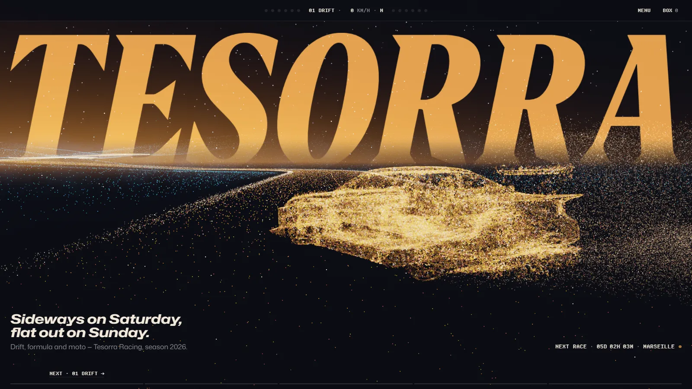

<p align="center">
  
</p>

<p align="center">
  <strong>Tesorra Racing — a concept site by Piotr Goworek</strong><br>
  <a href="https://tesorra.vercel.app">tesorra.vercel.app</a> · <a href="https://tesorra.vercel.app/en">English</a> / <a href="https://tesorra.vercel.app/pl">Polski</a>
</p>



The site of Tesorra Racing, a motorsport team known for drift, formula and moto, built as one continuous world: a winding track of amber dust that the camera rides down as you scroll, with a stop for every discipline, a floating team store and a countdown to the next race. The team, its drivers, results and products are fictional, and the store is a demo: nothing is sold, charged or shipped. All graphics, photography and video are generated and edited by me.

## Highlights

- **A world made of dust.** Plain WebGL2 in a Web Worker on an OffscreenCanvas (main-thread fallback, static poster without WebGL2): ~700k particles on desktop and 250k on phones, thinned adaptively to hold 60 fps, additive blending into an HDR buffer with ACES tone mapping, 5-level bloom, depth of field, curl-noise smoke and shape morphs. Point clouds of a drift car, a formula car and a motorcycle are sampled from 3D models.
- **Scroll is distance.** Scroll position maps to distance along a Catmull-Rom track; the camera speeds up between stops, banks into corners and slows down at each stop, where the vehicle runs a short scroll-driven loop.
- **A steering-wheel display instead of a nav bar.** Chapter, scroll speed in km/h, gear and shift lights that fill with the page and blink on a chapter change; digits flip like a timing screen.
- **Driver pages.** A huge outlined number, a portrait that bursts into dust and reassembles as the next driver, signatures drawn stroke by stroke, counters, a fan of paddock photos and a helmet archive.
- **A floating store.** Cut-out products drift in space over the dust, categories dissolve into each other, FLOAT / LIST views, a box drawer, a demo checkout validated in the browser and a paddock pass with a Code 39 barcode as the order confirmation.
- **Details.** Start lights as the intro, page transitions through dust, pit-board cards, an `.ics` file for every race, a “BOX, BOX” radio message on add to box, EN / PL, reduced-motion versions of every page.

**Stack:** Next.js 16 (App Router, React Server Components, Partial Prerendering), React 19, TypeScript (strict), Tailwind CSS 4, Lenis, Zustand, Zod, Vitest, Playwright, pnpm, Vercel. No 3D libraries.

## Lighthouse

Measured on production (`https://tesorra.vercel.app`) on 26 October 2026: Lighthouse 13.5.0, headless Chrome 156.0.8078.47, default simulated throttling (mobile: Moto G Power on slow 4G with a 4× slower CPU; desktop: the `desktop` preset). Three runs per row, each value is the median of the three.

| Page | Device | Performance | Accessibility | Best practices | SEO | FCP | LCP | TBT | CLS | Speed Index |
| --- | --- | --- | --- | --- | --- | --- | --- | --- | --- | --- |
| `/en` | Desktop | 98 | 100 | 100 | 100 | 0.4 s | 0.8 s | 2 ms | 0.001 | 1.6 s |
| `/en` | Mobile | 72 | 100 | 100 | 100 | 1.5 s | 4.3 s | 363 ms | 0 | 5.5 s |
| `/en/store` | Desktop | 97 | 100 | 100 | 100 | 0.3 s | 1.2 s | 5 ms | 0 | 0.9 s |
| `/en/store` | Mobile | 71 | 100 | 100 | 100 | 1.7 s | 5.0 s | 295 ms | 0 | 4.7 s |
| `/en/team/21-wierzbicki` | Desktop | 99 | 100 | 100 | 100 | 0.4 s | 0.8 s | 3 ms | 0.001 | 0.9 s |
| `/en/team/21-wierzbicki` | Mobile | 68 | 100 | 100 | 100 | 1.7 s | 5.5 s | 312 ms | 0.002 | 5.1 s |

Performance per run: `/en` desktop 98, 97, 98 · mobile 66, 72, 74; `/en/store` desktop 97, 97, 96 · mobile 87, 71, 71; `/en/team/21-wierzbicki` desktop 98, 99, 99 · mobile 73, 66, 68.

On mobile the LCP element is server-rendered HTML (the store heading, the driver portrait, a line of the home page header); the server answers in under 150 ms and almost all of the LCP is render delay while the simulated 4× slower CPU evaluates the JavaScript bundles. Evaluating those bundles (React and the app) is also the source of the TBT; the WebGL scene runs in a worker and adds nothing to the main thread.

## Development

Requires Node.js 24 and pnpm 12.

```bash
pnpm install        # dependencies
pnpm dev            # dev server at http://localhost:3000
pnpm lint           # ESLint
pnpm test           # unit tests (Vitest)
pnpm test:e2e       # end-to-end and accessibility tests (Playwright, builds the app first)
pnpm build          # production build
pnpm start          # serve the production build
pnpm images         # assets-src/ → responsive AVIF + WebP in public/img and lib/images.ts
```

No environment variables are required. Optional:

| Variable | Use |
| --- | --- |
| `NEXT_PUBLIC_SITE_URL` | Absolute origin for canonical links, `hreflang`, the sitemap and Open Graph. On Vercel the production domain is used automatically; locally it falls back to `http://localhost:3000`. |

## Rights

The source code is public for review only. The graphics, photography, video, the Tesorra wordmark and all product designs are © Piotr Goworek. All rights reserved: no part of this repository may be copied, modified or reused without my written permission. 3D models and fonts are used under their licences – see [/credits](https://tesorra.vercel.app/en/credits). Tesorra Racing is fictional and not affiliated with any racing series, team or brand.
